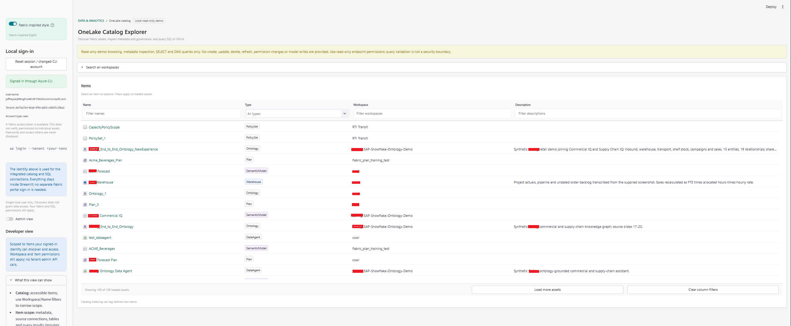
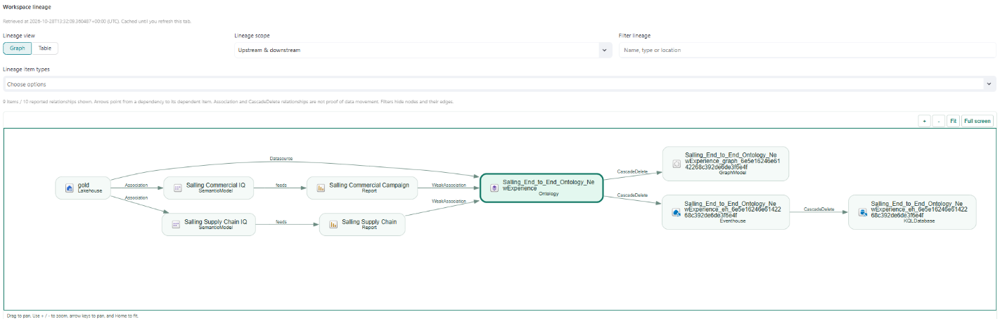
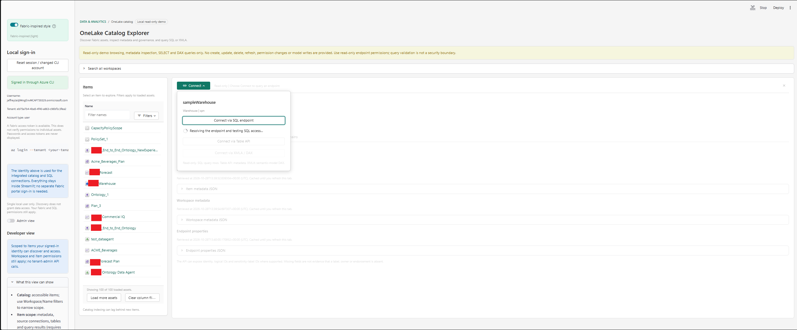
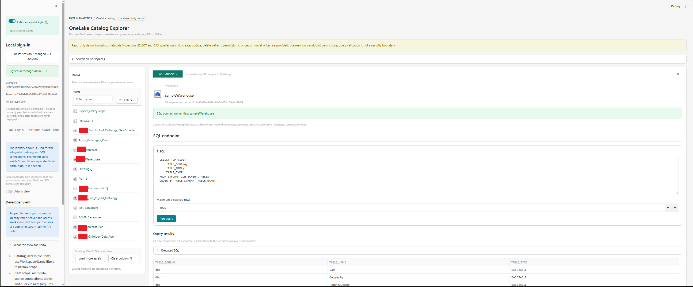
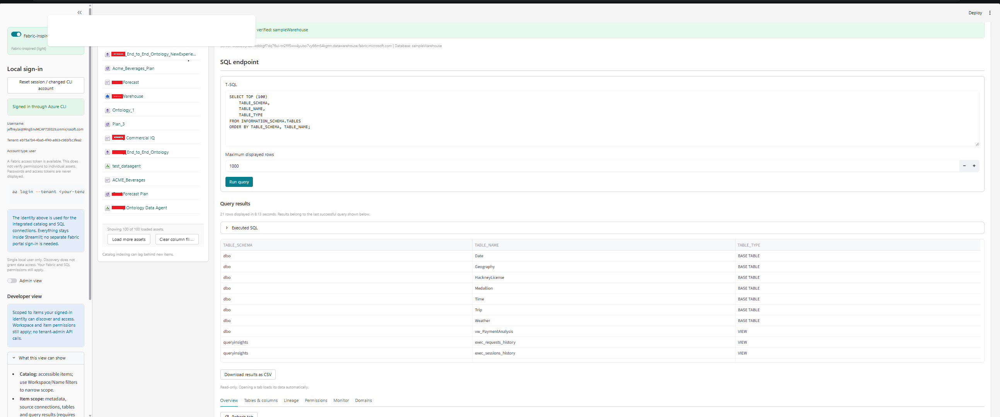

# OneLake Catalog Explorer

**OneLake catalog is already built into 100+ services. Now bring it into yours.**

OneLake catalog is an open, API-accessible platform in Microsoft Fabric, not just a discovery experience in
the Fabric portal. Its [public REST APIs](https://learn.microsoft.com/rest/api/fabric/articles/onelakecatalog/overview)
let you build asset discovery and metadata exploration into custom solutions.

This local, single-user Streamlit app demonstrates that approach: browse the
Fabric assets you can access, explore their metadata and lineage, and connect
to Warehouse/Lakehouse SQL endpoints or semantic models through XMLA using your
own identity. It is a custom application built on the APIs, not an embedded copy
of the Fabric portal. Existing Fabric and data permissions still apply.

> **Read-only demo.** The app provides discovery, metadata inspection, SELECT and
> DAX queries only. It does not create/change/delete items, modify models or
> permissions, trigger data refreshes, or assign domains. Query validation is not
> an authorization boundary: use read-only data permissions on the endpoints.

## See it in action

### An integrated catalog and asset explorer

Browse and filter accessible items, then select an asset to open its details
alongside the catalog. Metadata, connection options and exploration tools stay
inside the custom Streamlit experience.


### Visual lineage with Fabric item icons

Switch between graph and table views, explore upstream/downstream dependencies,
and filter by name or item type. The graph highlights the selected asset and
supports pan, zoom and full screen.



*Screenshots show an example workspace; sign-in details have been cropped out.
Lineage reflects relationships returned by the APIs, not a guarantee of complete
portal or table/column-level coverage.*

### Connecting to and querying data sources

Select an asset and open **Connect** to choose how to work with it. Connection
options adapt to the selected item:

- **SQL endpoint:** query a Warehouse or Lakehouse SQL analytics endpoint.
- **Table API:** explore supported schemas, tables and column metadata.
- **XMLA / DAX:** query a semantic model, subject to its endpoint configuration
  and your permissions.

For SQL connections, the app resolves the endpoint from Fabric and tests access
using your Azure CLI identity. After connecting, the detail pane shows the SQL
editor and result table; other connection types show their corresponding tools.
You stay inside the app, while the platform continues to enforce your existing
access permissions.



### Query a SQL endpoint and see the results


The catalog is more than a place to find an asset: you can connect to its data
endpoint and work with the results without leaving the app.

1. Select a **Warehouse** or **Lakehouse** in the catalog.
2. Choose **Connect > Connect via SQL endpoint**. The app resolves the endpoint
   and authenticates using your Azure CLI identity.
3. Enter a read-only query in the **T-SQL** editor and select **Run query**.
4. View the returned rows in a table inside Streamlit, or download them as CSV.
   The **Maximum displayed rows** setting limits the displayed result.


For example, assuming your endpoint has a `dbo.SalesOrders` table:

```sql
SELECT TOP (100)
    TABLE_SCHEMA,
    TABLE_NAME,
    TABLE_TYPE
FROM INFORMATION_SCHEMA.TABLES
ORDER BY TABLE_SCHEMA, TABLE_NAME;
```





### Platform security still applies

**Embedding the catalog does not bypass Fabric security or grant data access.**
Discovery, metadata requests and queries use the signed-in identity. Each API or
endpoint enforces its own applicable permissions and data policies, including
workspace/item access, SQL grants and row-/column-level restrictions where
configured and applicable to that identity.

Seeing an item in the catalog does **not** automatically let you query it.
Likewise, enabling **Admin view** does not grant SQL or semantic-model data
permissions. The platform decides what the identity may discover, inspect and
query; the app displays permission errors rather than bypassing those checks.

This local demo uses the host's Azure CLI account. Shared hosting requires
per-user Microsoft Entra authentication. Use read-only endpoint permissions:
the app's SELECT-only guardrails are not an authorization boundary.

Other capabilities include:

- **Read-only queries:** SQL results in the app, plus XMLA/DAX tooling for
  semantic models when endpoint configuration and permissions allow.
- **Tables and governance:** supported schema/table browsing, permissions,
  monitoring and domain metadata.
- **Developer/Admin views:** permission-scoped features, with admin APIs used
  only in Admin view; the toggle never grants additional access.
- **Fabric-inspired styling:** switch between the Fabric-inspired presentation
  and the original Streamlit style.

## Getting Started (Windows PowerShell)

Requires Python 3.11+, Streamlit 1.66+ (for native lazy tabs), Azure CLI, and
Microsoft ODBC Driver 18 for SQL Server (Driver 17 is also supported).

```powershell
python -m venv .venv

.\.venv\Scripts\python.exe -m pip install -r requirements.txt

az login --tenant <your-tenant-id>

.\.venv\Scripts\python.exe -m streamlit run app.py
```

Open <http://127.0.0.1:8501>. The app binds to loopback only.

If needed, install the [Azure CLI](https://learn.microsoft.com/cli/azure/install-azure-cli-windows)
and [Microsoft ODBC Driver](https://learn.microsoft.com/sql/connect/odbc/download-odbc-driver-for-sql-server).

## Detailed documentation

See the [detailed setup and usage guide](README-DETAILED.md) for XMLA bridge
setup, workflows, security, troubleshooting and technical reference.
